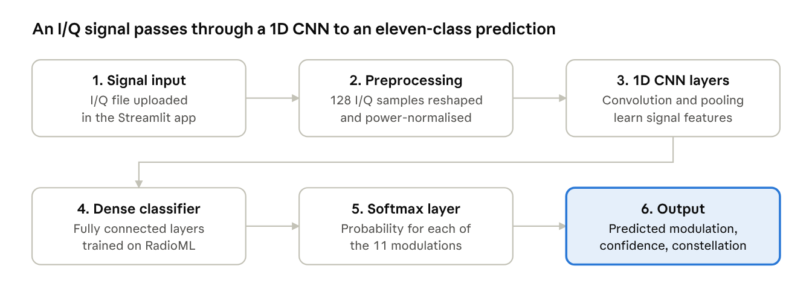
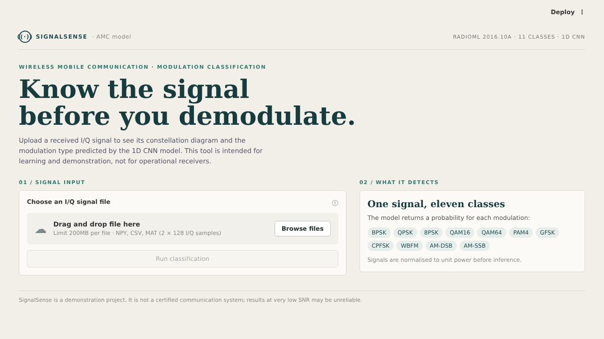

# Automatic Modulation Classification of Wireless Signals Using Deep Learning

**K S Prem | RA2311003050408** · Wireless Mobile Communication (WMC) project

A 1D Convolutional Neural Network that identifies the modulation type of a received radio
signal from its raw I/Q samples, served through a Streamlit web app (**SignalSense**).



## Modulation classes (11)

BPSK · QPSK · 8PSK · QAM16 · QAM64 · PAM4 · GFSK · CPFSK · WBFM · AM-DSB · AM-SSB

## How it works

1. **Signal input** – the user uploads an I/Q file (2 × 128 samples) in the web app.
2. **Preprocessing** – samples are reshaped to (128, 2) and normalised to unit power.
3. **1D CNN layers** – four Conv1D + BatchNorm + MaxPool blocks learn signal features.
4. **Dense classifier** – fully connected layers with dropout.
5. **Softmax layer** – probability for each of the 11 modulations.
6. **Output** – predicted modulation, confidence score, constellation and waveform plots.

## Project structure

```
├── app.py              # Streamlit web app (SignalSense)
├── train.py            # trains the CNN, saves model + plots to models/
├── make_samples.py     # writes test signal files to samples/
├── src/
│   ├── signals.py      # modulators, wireless channel, dataset loaders
│   └── model.py        # 1D CNN architecture (Keras)
├── docs/               # report figures
└── requirements.txt
```

## Setup

```bash
python -m venv venv
source venv/bin/activate        # Windows: venv\Scripts\activate
pip install -r requirements.txt
```

## Train

**Option A – synthetic dataset (no download, ~10 min on CPU):**

```bash
python train.py
```

The generator in `src/signals.py` creates RadioML-style bursts for all 11 modulations and
passes them through a channel with random phase, frequency offset, fading gain and AWGN
at SNRs from −20 dB to +18 dB.

**Option B – real RadioML 2016.10A dataset:**

Download `RML2016.10a_dict.pkl` from [DeepSig datasets](https://www.deepsig.ai/datasets),
put it in `data/`, then:

```bash
python train.py --radioml data/RML2016.10a_dict.pkl
```

Training saves to `models/`:

- `amc_cnn.keras` – the trained model
- `accuracy_vs_snr.png` – accuracy at each SNR level
- `confusion_matrix.png` – confusion matrix for SNR ≥ 10 dB
- `metrics.json` – overall and per-SNR accuracy

## Run the web app

```bash
python make_samples.py      # optional: creates test files in samples/
streamlit run app.py
```

Upload a `.npy` or `.csv` file from `samples/`, or use **Generate a test signal** to pick a
modulation and SNR. The app shows the constellation diagram, the I/Q waveform, the
predicted modulation and its confidence.



## Notes

- Accuracy drops at low SNR (below about 0 dB) — this is expected and is shown in the
  accuracy-vs-SNR plot.
- This is a learning demonstration, not a certified communication system.

## License

MIT
